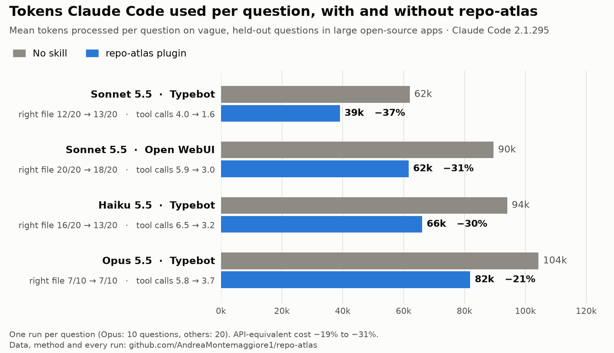

# repo-atlas

A [Claude Code](https://code.claude.com) skill for finding code in large or messy repositories with fewer turns.
When Claude invokes it with a few search words, the skill runs a local lookup **inside the invocation itself**
and returns the best-matching functions with their code. The usual Grep → Read → Read chain shrinks to a call or two.

The lookup runs on a map of the repo, `.atlas/`, built locally in seconds without any model tokens. The map holds
symbols with line ranges, import-graph ranking, files that change together, copy-pasted duplicates, unreferenced
files and generated noise. These are the things that waste turns in vibe-coded repos.

**In short**: on vague questions in large open-source apps, Claude Code with the plugin used **21–37% fewer tokens**
and made 35–60% fewer tool calls on Claude Code 2.1.288–2.1.295. It found the right file about as often as without
it. On 2.1.300 the baseline itself got cheaper and the saving shrank to **13%**, which is within the noise in a
3-repetition check; there the plugin's final answers were graded correct about twice as often. With Haiku it lost
3 of 20 questions, and it does not pay off in small repos. All the numbers, limits and raw data are below.



## Why turns, not bytes

Each tool call sends the whole conversation back to the model. In our measurements one API call carried
13–23k tokens of fixed context, depending on the CLI version, while 100 lines of code cost about 1.5k. A first
version of this skill gave Claude a better map but added turns: invoke the skill, read the instructions, run
the search, read the results. It **cost 1.4–1.7× more** than no skill at all. The current version answers in
the same turn as the invocation.

## What Claude sees

The search output (abridged, gPodder):

```
## resize cover pixbuf keep aspect ratio  (terms: resiz cover pixbuf keep aspect ratio)
1. src/gpodder/gtkui/model.py::PodcastListModel._resize_pixbuf_keep_ratio L662-688 [name+grep]
   662|     def _resize_pixbuf_keep_ratio(self, url, pixbuf):
   663|         """Resizes a GTK Pixbuf but keeps its aspect ratio.
   ...
2. src/gpodder/gtkui/model.py::PodcastListModel._resize_pixbuf L690-694 [grep+name]
   ...
other matching files: src/gpodder/gtkui/services.py, src/gpodder/coverart.py, src/gpodder/gtkui/desktop/channel.py, src/gpodder/gtkui/main.py
```

When invoked with no search words, it shows the map brief instead:

```
127 files, 31857 code lines; py:111, sh:9
central files: src/gpodder/__init__.py (L250 in=74), src/gpodder/util.py (L2399 in=50), ...
monolith src/gpodder/gtkui/main.py L4029 (173 syms), biggest: gPodder 73-4029
suspects: 3 duplicate bodies; 6 names defined in several files; 4 unreferenced files? (verify before trusting)
```

Results marked `same body:` are copy-pasted code, so change every copy or find the live one. `name also in:` marks
the same name defined in several files.

## Install

As a plugin. This repository is also its own marketplace:

```bash
claude plugin marketplace add AndreaMontemaggiore1/repo-atlas
```

```bash
claude plugin install repo-atlas@repo-atlas
```

The plugin is the recommended install. Besides the skill, it has a `SessionStart` hook. In a repo that has a map,
or in a git repo with at least 200 tracked code files, the hook tells Claude at the start of each session to use the
skill. That makes Claude use it consistently, starting with the first question in a repo it has never seen, and it
does not touch any file. Elsewhere, in small repos and folders without git, the hook adds nothing. When it fires it
adds about 50 tokens to the session.

Or as a plain skill: copy `skills/repo-atlas/` to `~/.claude/skills/repo-atlas/` for every project, or to
`<repo>/.claude/skills/repo-atlas/` for one project. Without the plugin's hook, let Claude run
`atlas init --claude-md` after the first use, or ask it to "set up the repo-atlas pointer". This adds the same
pointer as two lines in the repo's `CLAUDE.md`, and the skill asks before writing there.

Pick one of the two: with both the plugin and a copied skill, Claude sees the skill twice.

**Use**: nothing to set up. Ask Claude where something is implemented, or describe a behaviour or a bug. Claude
invokes the skill, and the first lookup in a repo builds the map (seconds; about 20 s for a 13k-file repo). Above
30,000 code files the first map is built in the background, and Claude uses Grep until it is ready. To call it
yourself, run `/repo-atlas:repo-atlas where checkout totals are computed` with the plugin, or `/repo-atlas …` with
the plain skill.

Other agents that read Agent Skills can use `skills/repo-atlas/` as well. There the model runs the lookup command
itself, because the automatic lookup is a Claude Code feature. This is untested.

**Requirements**: Python 3.9+ on `PATH` and bash (Git Bash on Windows). git is optional (it adds churn and
co-change data), and so is ripgrep (faster search). There are no dependencies and no network access, and the
code and the map never leave your machine.

## Results

Every run is a real headless Claude Code session on a fresh copy of a public repo, asked one question: "where is
the code I would change for …?". The gold answer is the files the original commit touched. The questions below
are **vague**: an LLM rewrote each commit subject as a product owner would ask it, with no code names. They are
**held out**, meaning they were generated and run without being used to tune the skill. Costs are API-equivalent.
The method, the data of every run and the scripts are in [`bench/`](bench/README.md).

Arms: **A** has no skill. **S** is the skill alone. **P** is the skill plus the 2-line `CLAUDE.md` pointer.
**H** is the plugin as shipped: the skill plus the hook. hit@3 means a gold file is among the first three files
the answer names.

| repo (size) | model | hit@3 out of 20: A / S / P / H | tokens vs A: S / P / H | API cost vs A: S / P / H |
|---|---|---|---|---|
| Open WebUI (278k lines, Python + Svelte) | Sonnet 5.5 | 20 / 20 / 19 / 19 | 0.85 / 0.72 / **0.70** | 0.90 / 0.83 / **0.80** |
| Typebot (167k lines, Next.js) | Sonnet 5.5 | 18 / 16 / 18 / 17 | 0.88 / 0.89 / **0.77** | 0.86 / 0.89 / **0.80** |
| LibreChat (React + Node) | Sonnet 5.5 | 18 / 15 / 16 / – | 0.67 / 1.07¹ / – | 0.75 / 0.92 / – |
| Dify (Python + Next.js, 13k files) | Sonnet 5.5 | 16 / 17 / 17 / – | 0.96 / 0.74 / – | 1.00 / 0.80 / – |
| Typebot | Haiku 5.5 | 16 / 15 / – / 15 | 0.59 / – / **0.54** | 0.66 / – / **0.65** |
| Open WebUI | Haiku 5.5 | 18 / 18 / – / 17 | 0.59 / – / **0.53** | 0.67 / – / **0.67** |
| Typebot, 20 newer questions, CLI 2.1.295 | Sonnet 5.5 | 12 / – / – / **14** | – / – / **0.68** | – / – / **0.82** |
| Typebot, 10 of those questions, CLI 2.1.295 | Opus 5.5 | 7 / – / – / 7 (out of 10) | – / – / 0.90 | – / – / 0.86 |

¹ One question that every arm failed cost P 1.26M tokens. P's median question cost 0.71× A's.

Reports: [Open WebUI](bench/report_v22.md), [Typebot](bench/report_v23.md), [H](bench/report_h1.md),
[LibreChat and Dify](bench/report_v24.md), [Haiku](bench/report_haiku1.md), [latest CLI and Opus](bench/report_final.md).

**Re-check after a Claude Code update** (2026-10-14, same CLI number 2.1.295 but a new build, same questions):

| set | model | hit@3: A / H / H0 | tokens vs A: H / H0 | API cost vs A: H / H0 |
|---|---|---|---|---|
| Typebot, newer questions (20) | Sonnet 5.5 | 12 / 13 / 13 | **0.63** / 0.69 | 0.81 / 0.82 |
| Open WebUI (20) | Sonnet 5.5 | 20 / 18 / 20 | 0.69 / 0.78 | 0.81 / 0.87 |
| Typebot, newer questions (20) | Haiku 5.5 | 16 / 13 / – | 0.70 / – | 0.69 / – |
| Typebot, newer questions (10) | Opus 5.5 | 7 / 7 / – | 0.79 / – | 0.79 / – |

H0 is the plugin on a repo it has never seen, with no map yet: the first lookup builds it. Reports:
[re-check](bench/report_recheck.md), [H0](bench/report_h0.md), [Haiku](bench/report_recheck_haiku.md),
[Opus](bench/report_recheck_opus.md).

**Repetitions and end result** (2026-10-14, CLI 2.1.300, Sonnet 5.5): the newer Typebot set again, each question
run 3 times per arm. `bench/judge.py` also graded every final answer against the commit that resolved the
question, without knowing the arm.

| metric | A | H | H − A, bootstrap 95% interval |
|---|---|---|---|
| hit@3 per repetition (of 20) | 14, 14, 15 | 13, 14, 14 | −3 points [−17, +8] |
| answer graded correct per repetition (of 20) | 4, 3, 5 | 8, 8, 8 | +20 points [+5, +35] |
| answer graded correct or partial | 80% | 73% | |
| tokens vs A | | 0.87 | [0.75, 1.02] |
| tool calls per question | 3.8 | 2.4 | |

The same arm moves by about one question between repetitions, so a one- or two-question gap in a single run is
noise. A's tokens on these questions fell from 61k to 45k between CLI 2.1.295 and 2.1.300, and the plugin's
saving fell with them. The grader favours short, committed answers, and the plugin's are shorter, so read the
correct-answer gain as "no loss in answer quality", not proof of a gain. Report: [repetitions](bench/report_reps.md).

What this means:

- **With the plugin, Claude does the same job with less work.** On CLI 2.1.288–2.1.295 it used 23–37% fewer
  tokens with Sonnet 5.5 and about half with Haiku 5.5, makes 2–5 fewer tool calls per question, and costs 18–35% less. Cost falls less than
  tokens because most input tokens are cache reads, which are already cheap. On a Pro/Max plan the saving shows up
  as plan usage. Opus 5.5 saves less: 10–21% of tokens and 14–21% of cost in two 10-question checks, because it
  keeps checking for itself even with the skill. On CLI 2.1.300 the Sonnet saving was 13% and not significant
  (3 repetitions, interval 0.75–1.02×), while tool calls still fell from 3.8 to 2.4 per question.
- **The pointer is what makes it pay.** Alone (S), Claude decides from the description whether to use the skill.
  On Dify it saved nothing, and spontaneous use is falling: the same description fired on 10/10 relevant prompts
  with Claude Code 2.1.288, 8/10 with 2.1.293 and 6/10 with the latest build. With the hook or the CLAUDE.md
  pointer, the skill is used on every question, including the first one in a big repo (H0).
- **Accuracy is slightly lower on vague questions.** Pooled over the four Sonnet repos, A found the right file in
  90% of the questions, S in 85% and P in 87.5%. The skill arms won 2–3 questions and lost 5–6, which is not
  significant but always in the same direction: about one vague question in 20. The cause is known. On vague
  questions the lookup misses the right file about half the time, and Claude sometimes settles on its candidates
  instead of searching further. With the plugin (H) over the three Sonnet sets where it ran, the score is even:
  50/60 against A's 50/60. On questions that name the code it is as accurate or better.
- **When it does not help**: small repos, and questions that already name the function, where Grep is enough.
  The skill's description also sits in the context of every call, about 190 tokens. A shorter one, about 84
  tokens, made the skill fire on 5/10 relevant prompts instead of 8/10, so it was [dropped](bench/report_desc.md).
- **How it got here.** The first design gave Claude a map but added turns, and it cost **1.4–1.7× more** than no
  skill on Sonnet 5 (CLI 2.1.281). Turns dominate the cost, so the current design answers in the invocation turn.
  Two earlier rounds, [v2](bench/report_v2.md) on gPodder and Formbricks and [v2.1](bench/report_v21.md), show
  the path, including a round where the skill lost 2–4 of 20 questions before a ranking fix.
- **Limits**: one repetition per question except in the repetitions round, and between rounds A itself moved by
  6–11 points on the same questions. The vague questions were written by an LLM, and the gold answer is the files of one commit. Opus ran
  on 10 questions only. The end-result grader is itself a Sonnet session. The benchmark sessions ran on Windows,
  except the repetitions round on Linux; the unit tests also run on Linux and macOS in CI.
  The numbers come from Claude Code 2.1.288–2.1.300, and since every CLI release changes the cost of a turn,
  re-run [`bench/`](bench/README.md) before trusting them on a newer one.

## What it runs, writes and sends

- **The skill**, when Claude invokes it, runs `bash skills/repo-atlas/scripts/atlas find …`, which is Python. It
  reads the repo's files and runs read-only `git` commands (`ls-files`, `diff`, `status`, `log`, `rev-parse`), plus
  ripgrep and ctags if they are installed.
- **The plugin's SessionStart hook** runs `atlas session-start`. It checks for `.atlas/` and runs `git ls-files`
  to count code files, prints at most one line for Claude's context, and writes nothing.
- **It writes only inside `.atlas/` in your repo**: the map (`_map.md`, `_map.json`, `symbols.json`, `meta.json`),
  a `.gitignore`, `notes.md` when Claude records notes, and a temporary `building` lock. `atlas init --claude-md`
  adds two lines to `CLAUDE.md`, and only when you approve it.
- **Background process**: in repos with more than 30,000 code files, the first map is built by a detached
  `atlas map` process, which exits when the map is written.
- **Network**: none. Nothing is sent or fetched, and there is no telemetry.

## FAQ

**Doesn't Anthropic say that grep beats indexing?** The Claude Code team has said they replaced a vector-database
index with agentic search, where the model drives Grep and Glob, because it worked better and has no stale index
or privacy problems. repo-atlas does not bring embeddings or a vector store back. Its lookup is lexical: BM25 over
symbol names, paths, matching lines and your notes. The map adds repo structure (imports, git history, duplicates)
for the brief and the warnings, and everything runs locally. The model still drives the search: the lookup is one
fast first step that returns code, and Claude greps or reads further when the result is only nearby. What it
removes are the extra turns, not the agentic search.

**Does the map stay up to date when the code changes?** Yes, for search. On every lookup, git lists the files that
changed since the map was built: commits, merged PRs, pulls and uncommitted edits. Those files are re-read for that
query, and with more than 50 changed code files the whole map is rebuilt automatically. The repo-wide parts (central
files, duplicates, files that change together, the brief) refresh only on a full rebuild or `atlas map`. Without
git, changes are not detected, so run `atlas map`. The map only sees your working copy, so a PR you have not pulled
is not in it.

**Where is the map, and can I commit it?** In `.atlas/` at the repo root. Generated files are git-ignored. Only
`notes.md` is worth committing, if you use notes.

**Does it send my code anywhere?** No. The scripts are plain Python and bash with no dependencies and no network
access, and the pre-approved command is only the skill's own script.

## Related work

- **[aider](https://aider.chat)'s repo map** inspired the ranked map: tree-sitter symbols plus PageRank over
  references. aider puts a token-budgeted map in the context on every turn. repo-atlas keeps the map out of the
  context and answers a query on demand, with the matching code, inside the skill invocation.
- **[Serena](https://github.com/oraios/serena)** gives the agent IDE-like symbol tools through language servers, an
  MCP server with many tools. repo-atlas is a single skill with no server, plus signals for messy repos:
  copy-pasted bodies, names defined in several files, files that change together, unreferenced and generated files.
- **[Claude Context](https://github.com/zilliztech/claude-context)** and similar MCP servers add semantic search
  through embeddings and a vector database. repo-atlas has no embeddings (see the FAQ).
- Several of these tools publish larger savings than the ones above. Those figures often come from estimates or
  from different baselines. The numbers here come from paired runs against no skill, on questions held out from
  tuning, with every run's data in [`bench/results/`](bench/results).

## How this was built

repo-atlas was developed with Claude Code driven by Claude Opus 5.5, over 13 days and about 50 commits. It went
through 5 versions of the skill and 12 benchmark rounds, about 1,570 headless sessions in all. Every number in
this README comes from those sessions.

## Commands

Claude runs these itself. You can also run them from a terminal: `bash <skill dir>/scripts/atlas <command>`.

| command | what it does |
|---|---|
| `find "q1" "q2"` | ranked symbols with their code, several searches in one call (builds the map on first use) |
| `find` | the map brief |
| `map` | rebuild `.atlas/` |
| `note "path::Symbol \| text"` | record a fact a search would miss (code in a surprising place, a trap, which duplicate is live). Notes appear with later search results |
| `check [--fix-lines]` | validate notes against the code |
| `init [--claude-md]` | write `.atlas/.gitignore` (generated files are ignored, `notes.md` can be committed) and optionally the CLAUDE.md pointer |
| `gate` | optional hook that blocks whole-file reads of big code files ([references/enforce.md](skills/repo-atlas/references/enforce.md)) |

## Development

```bash
python -m pytest -q tests
```

CI runs the tests on Python 3.9–3.13 on Linux, macOS and Windows. The optional tree-sitter parsers in
`requirements-dev.txt` replace the regex symbol extraction for JS/TS/Go/Java/Rust when installed.

## License

MIT
